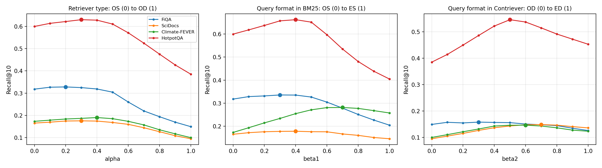
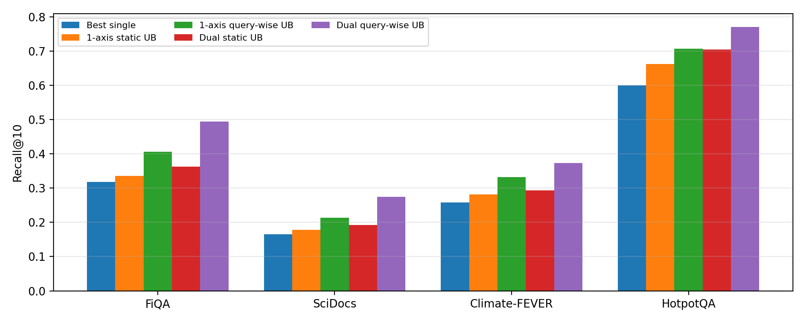
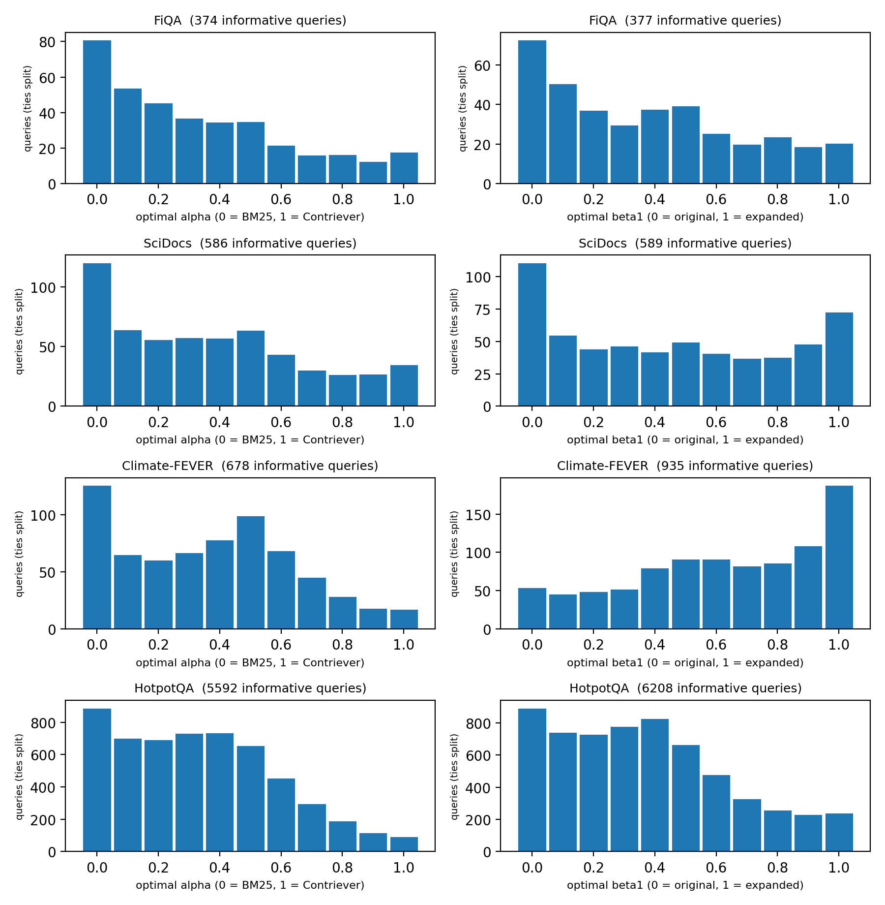
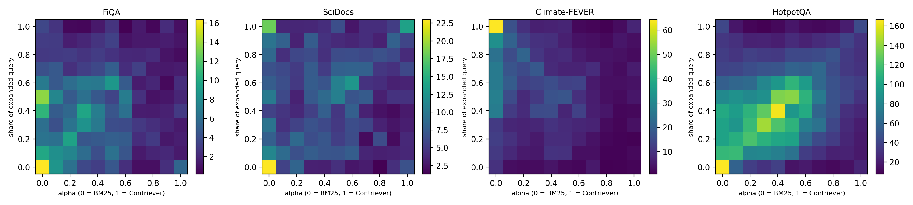

# QuDAR Replication – Truy xuất thông tin (CS419)

Tái hiện và mở rộng bài báo **QuDAR: Query-Wise Dual-Perspective Adaptive Retrieval** (ACL 2026, KAIST) cho đồ án môn Truy xuất thông tin (CS419), UIT. Đồ án thuộc bài toán **"Chọn công thức tính giá trị xếp hạng tốt nhất"**: QuDAR trộn 4 danh sách kết quả (BM25 / Contriever × query gốc / query mở rộng) bằng trọng số riêng cho từng câu truy vấn.

- Paper: QuDAR, ACL 2026 (Long Papers)
- Code gốc của tác giả: <https://github.com/kaist-dmlab/QuDAR> (không chép vào repo này; notebook tự `git clone` khi chạy)
- Thực hiện: `Bùi Huy Chương` – `24520230`

## Trạng thái

| Step | Nội dung | Trạng thái |
|---|---|---|
| 0 | Chuẩn bị dữ liệu, môi trường | ✅ |
| 1 | BM25 (bm25s), encode Contriever, sinh query mở rộng bằng LLaMA 3.1-8B-Instruct | ✅ |
| 2 | 4 danh sách truy xuất OS / OD / ES / ED (top-1000) | ✅ |
| 3 | Fusion và baseline: Static Avg/UB, RRF, Equal, Confidence, DAT | ✅ |
| 4 | QuDAR-llm (gpt-4o-mini) + ablation prompt × thứ tự | ✅ |
| 5 | Phân tích: Table 8, Figure 2–5 | ✅ |
| 6 | Mở rộng: học trọng số theo query, khử thiên lệch vị trí, kiểm định thống kê | ⏳ |
| 7 | Đánh giá RAG end-to-end | ⏳ |
| 8 | Demo | ⏳ |
| 9 | Báo cáo | ⏳ |

## Quy trình truy xuất trong đồ án

| Khâu | Sparse (BM25) | Dense (Contriever) |
|---|---|---|
| Tài liệu | 4 corpus BEIR, ghép `title + text` | như bên cạnh |
| Phân tích tài liệu | chữ thường, tách từ regex, bỏ stopword tiếng Anh, stemming Snowball (PyStemmer) | WordPiece, tối đa 512 token, tiền tố `passage: `, mean pooling, chuẩn hóa L2 → vector 768 chiều |
| Lập chỉ mục | inverted index của bm25s (ma trận thưa term × tài liệu, trọng số BM25 tính sẵn, k1 = 1.5, b = 0.75) | FAISS IndexFlatIP (FiQA, SciDocs); shard fp16 (Climate-FEVER, HotpotQA) |
| Phân tích câu truy vấn | cùng bộ tách từ + **mở rộng query bằng LLaMA 3.1-8B-Instruct** | tiền tố `query: ` (gốc), `passage: ` (mở rộng) |
| Truy xuất chỉ mục | posting list → điểm BM25, top-1000 | tích vô hướng toàn bộ, top-1000 |
| **Xếp hạng (trọng tâm)** | chuẩn hóa min-max rồi trộn 4 danh sách: Static, RRF, Equal, Confidence, LLM, DAT, trọng số học được (Step 6) | |

## Dữ liệu và mô hình

| Thành phần | Lựa chọn |
|---|---|
| Dataset | FiQA (57.638 tài liệu / 648 query test), SciDocs (25.657 / 1.000), Climate-FEVER (5.416.593 / 1.535), HotpotQA (5.233.329 / 7.405); train: FiQA 5.500, HotpotQA 10.000 query đầu |
| Sparse | bm25s, phương pháp lucene, stopword tiếng Anh, PyStemmer |
| Dense | `facebook/contriever` |
| Mở rộng query | `meta-llama/Llama-3.1-8B-Instruct`, prompt Phụ lục G, giải mã tham lam (greedy), tối đa 256 token |
| LLM chấm điểm | `gpt-4o-mini`, temperature 0 |
| Chỉ số | Recall@10, nDCG@10, Precision@1 (pytrec_eval) |

## Cấu trúc repo

```
scripts/      phần bổ sung cho pipeline của tác giả (xem bảng dưới)
notebooks/    notebook Kaggle/Colab, đánh số theo thứ tự chạy
results/      kết quả nhỏ: CSV đánh giá, điểm LLM, bảng và hình cuối
logs/         log Kaggle (mốc thời gian từng bước)
docs/         findings.md: các chỗ code công bố lệch paper và kết quả ablation
```

| Script | Step | Việc |
|---|---|---|
| `bm25_fast.py`, `apply_patch.py` | 1–2 | Thay `rank_bm25` của repo gốc bằng bm25s (cấu hình khớp paper, chạy được 5 triệu tài liệu) |
| `encode_shards.py`, `build_index_from_shards.py` | 1 | Encode corpus lớn thành shard fp16, chạy tiếp được khi bị ngắt |
| `expand_queries.py` | 1 | Sinh query mở rộng (vLLM, dự phòng transformers) |
| `check_datasets.py` | 2 | Kiểm tra cấu trúc và số lượng các dataset Kaggle |
| `run_retrieval.py` | 2 | 4 danh sách truy xuất + mọi kết quả không cần LLM; cho `eval_results.csv` trùng với `qudar.cli`, tiết kiệm RAM, tìm dense trên GPU |
| `grid_sweep.py` | 3, 5 | Lưới 1.331 tổ hợp (α, β1, β2) cho từng query: Static Avg/UB 4 danh sách, cận trên theo query |
| `llm_score.py` | 3–4 | gpt-4o-mini chấm top-1: `paper`, `code`, `paper_fixed`, `code_shuffle`, `dat` |
| `step5_analysis.py` | 5 | Bảng so với paper, Figure 2–5, thống kê thiên lệch vị trí |

## Dataset trên Kaggle

File lớn (index, shard, `retrieval_result.json`, `grid_metrics.npz`) không nằm trong repo mà ở các dataset sau:

| Dataset | Nội dung |
|---|---|
| [qudar-beir-data](https://www.kaggle.com/datasets/karrychuong/qudar-beir-data) | 4 bộ BEIR (corpus, query, qrels) |
| [qudar-patches](https://www.kaggle.com/datasets/karrychuong/qudar-patches) | thư mục `scripts/` |
| [qudar-index-small](https://www.kaggle.com/datasets/karrychuong/qudar-index-small) | FAISS index FiQA, SciDocs |
| [qudar-shards-climate-fever](https://www.kaggle.com/datasets/karrychuong/qudar-shards-climate-fever), [qudar-shards-hotpotqa](https://www.kaggle.com/datasets/karrychuong/qudar-shards-hotpotqa) | 11 shard embedding fp16 mỗi bộ |
| [qudar-expansions](https://www.kaggle.com/datasets/karrychuong/qudar-expansions) | query mở rộng (test 4 bộ, train FiQA + HotpotQA) |
| [qudar-runs](https://www.kaggle.com/datasets/karrychuong/qudar-runs) | output Step 2 |
| [qudar-grid](https://www.kaggle.com/datasets/karrychuong/qudar-grid) | output `grid_sweep.py` |
| [qudar-llm](https://www.kaggle.com/datasets/karrychuong/qudar-llm) | điểm LLM, QuDAR-llm, DAT |
| [qudar-llm-ablation]() | ablation |

## Cách chạy lại

Mọi notebook chạy trên Kaggle (Colab với `01a`), cần bật Internet. Secret: `HF_TOKEN` (LLaMA), `OPENAI_API_KEY` (Step 4).

| Notebook | Máy | Thời gian | Ghi chú |
|---|---|---|---|
| `00_prepare_data` | CPU | khoảng 15 phút | tải BEIR, tạo `qudar-beir-data` |
| `01a_bm25_dense_check_colab` | Colab T4 | khoảng 30 phút | index FiQA, SciDocs; chẩn đoán BM25 / OD / ED |
| `01b_encode_climate-fever`, `01b_encode_hotpotqa` | T4 ×2 | khoảng 2,6 / 2 giờ | chạy song song trên 2 tài khoản |
| `01c_query_expansion_test`, `01c_query_expansion_train` | T4 ×2 | vài giờ | vLLM, LLaMA 3.1-8B-Instruct fp16 |
| `02_retrieval_*` | T4 ×1 | 15 phút / 30 phút / 3 giờ | FiQA + SciDocs / Climate-FEVER / HotpotQA |
| `03_grid_sweep` | CPU | khoảng 50 phút | |
| `04_llm_scoring_test`, `04_llm_scoring_train`, `04_llm_ablation_fiqa` | CPU | khoảng 2 / 1,5 giờ / 10 phút | tổng chi phí OpenAI khoảng 5 USD |
| `05_analysis` | CPU | khoảng 5 phút | |

## Kết quả chính

Recall@10 trên tập test, **của đồ án / paper** (bảng đầy đủ với nDCG@10 và P@1: [`results/step5_analysis/table_main.md`](results/step5_analysis/table_main.md)).

| Phương pháp | FiQA | SciDocs | Climate-FEVER | HotpotQA |
|---|---|---|---|---|
| OS (BM25, query gốc) | 0.3178 / 0.3135 | 0.1653 / 0.1655 | 0.1733 / 0.1750 | 0.5995 / 0.6039 |
| OD (Contriever, query gốc) | 0.1492 / 0.1649 | 0.0950 / 0.1112 | 0.0999 / 0.1235 | 0.3849 / 0.4011 |
| ES (BM25, query mở rộng) | 0.2047 / 0.2085 | 0.1459 / 0.1497 | 0.2576 / 0.2598 | 0.4047 / 0.4151 |
| ED (Contriever, query mở rộng) | 0.1261 / 0.1835 | 0.1361 / 0.1487 | 0.1234 / 0.1960 | 0.4526 / 0.4838 |
| DAT | 0.2894 / 0.2842 | 0.1624 / 0.1614 | 0.1679 / 0.1699 | 0.6009 / 0.5781 |
| Static UB (4 danh sách) | 0.3631 / 0.3715 | 0.1925 / 0.1917 | 0.2929 / 0.2972 | 0.7041 / 0.7110 |
| QuDAR-simple (RRF) | 0.3145 / 0.3219 | 0.1877 / 0.1893 | 0.2422 / 0.2411 | 0.6700 / 0.6741 |
| QuDAR-simple (Equal) | 0.3333 / 0.3402 | 0.1901 / 0.1906 | 0.2504 / 0.2464 | 0.6828 / 0.6924 |
| QuDAR-confidence | 0.3354 / 0.3438 | 0.1907 / 0.1920 | 0.2507 / 0.2473 | 0.6853 / 0.6962 |
| QuDAR-llm | 0.3281 / 0.3639 | 0.1899 / 0.1920 | 0.2567 / 0.2583 | 0.6704 / 0.6883 |
| Query-wise UB (4 danh sách) | 0.4944 / 0.5011 | 0.2749 / 0.2745 | 0.3734 / 0.3859 | 0.7708 / 0.7891 |

Tóm tắt:
- Các biến thể QuDAR không dùng LLM và các cận trên lệch paper trong khoảng ±3%; độ lệch lớn tập trung ở retriever dense (OD, ED).
- Cận trên khi chọn trọng số riêng cho từng query cao hơn trọng số tĩnh tốt nhất 9–43% (Recall@10), xác nhận động lực của paper.
- Code công bố và mô tả trong paper khác nhau ở nhiều chỗ, chi tiết trong [`docs/findings.md`](docs/findings.md).



 
  
 

## Ghi nhận

Dữ liệu từ BEIR; code pipeline gốc, prompt và số liệu so sánh từ paper QuDAR và repo của tác giả. Các script trong `scripts/` là phần đồ án bổ sung.
