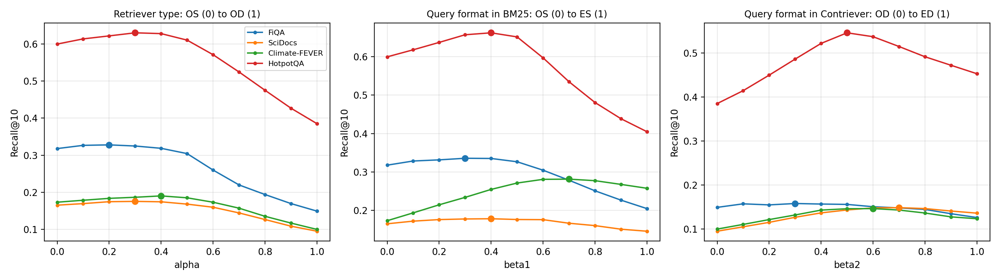
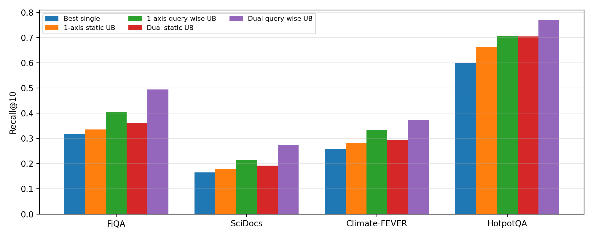
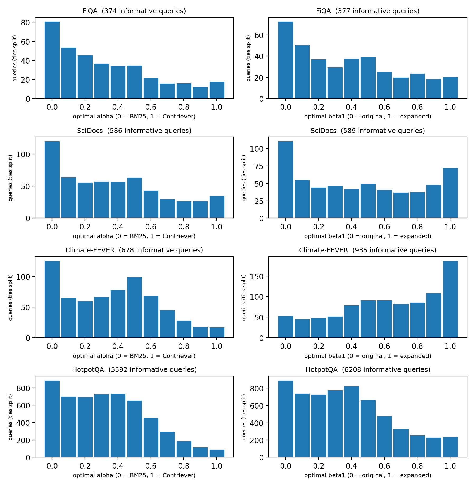
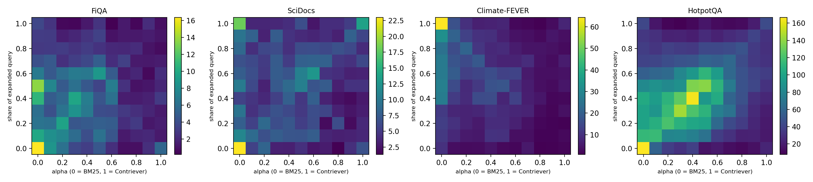
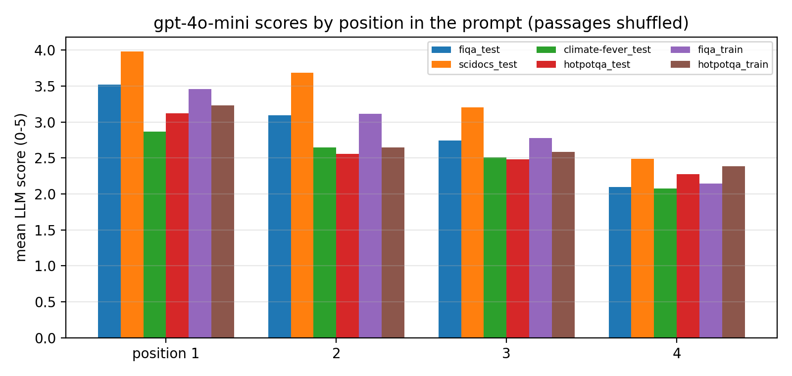
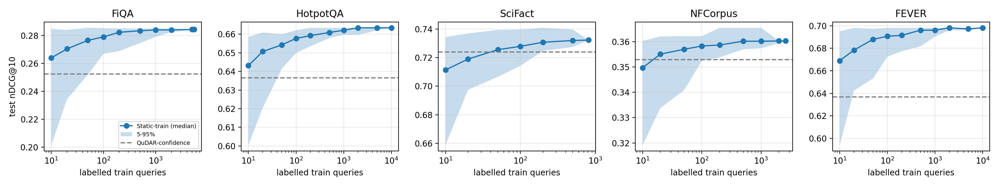

# QuDAR Replication – Truy xuất thông tin (CS419)

Tái hiện và mở rộng bài báo **QuDAR: Query-Wise Dual-Perspective Adaptive Retrieval** (ACL 2026, KAIST). QuDAR trộn 4 danh sách kết quả (BM25 / Contriever × query gốc / query mở rộng bằng LLM) bằng trọng số riêng cho từng câu truy vấn.

Repo gồm hai phần:

1. **Đồ án môn Truy xuất thông tin (CS419), UIT** (Step 0–9): tái hiện QuDAR trên đúng 4 bộ BEIR của paper. Đồ án thuộc bài toán "Chọn công thức tính giá trị xếp hạng tốt nhất".
2. **Phần mở rộng sau đồ án** (Step 10, xong ngày 26/11/2026): mở rộng lên 8 bộ BEIR, 5 bộ có dữ liệu train và 2 LLM chấm (gpt-4o-mini và Qwen2.5-7B-Instruct), kiểm định lại mọi kết luận có hiệu chỉnh Holm. Đây là phần thí nghiệm cho một bài reproducibility đang viết.

- Paper: QuDAR, ACL 2026 (Long Papers) — [ACL Anthology](https://aclanthology.org/2026.acl-long.1791/)
- Code gốc của tác giả: <https://github.com/kaist-dmlab/QuDAR> (không chép vào repo này; notebook tự `git clone` khi chạy)
- Thực hiện: `Bùi Huy Chương` – `24520230`

## Kết quả chính

| | Kết quả | Chi tiết |
|---|---|---|
| Tái hiện | Trên 4 bộ của paper, số của đồ án lệch paper tối đa 3,3% Recall@10, nhưng chỉ sau khi sửa cấu hình BM25 của code công bố | [Kết quả đồ án](#kết-quả-đồ-án-step-5) |
| Phát hiện 1 | Code công bố khác paper ở 4 điểm: thư viện BM25 (chạy nguyên code thì BM25 trên FiQA thấp hơn khoảng 30%), tiền tố của Contriever, cách encode ED, thứ tự và prompt của nhánh LLM | [`docs/findings.md`](docs/findings.md) mục 1–5 |
| Phát hiện 2 | Một bộ trọng số cố định chọn trên train cùng bộ (Static-train) cao hơn cả ba biến thể QuDAR ở 30/30 phép so trên 5 bộ có train, 18 phép có ý nghĩa sau Holm; khoảng 200 query có nhãn là đủ để vượt QuDAR-confidence trong 96–100% số lần rút | [Step 10d-2](#phát-hiện-2-trên-5-bộ-có-train-step-10d-2) |
| Phát hiện 3 | Làm đúng theo paper, QuDAR-llm không vượt cách chia đều (Equal) ở 7/8 bộ với cả hai LLM chấm; LLM chấm thiên lệch theo vị trí tài liệu trong prompt ở 32/32 kiểm định, và thứ tự cố định của code dồn trọng số vào vị trí mà từng LLM ưu ái | [Step 10d-1](#phát-hiện-3-trên-8-bộ-step-10d-1) |
| RAG | Khác biệt lớn ở truy xuất (trộn so với BM25 đơn) chuyển thành câu trả lời tốt hơn ở HotpotQA; khác biệt nhỏ giữa các cách trộn chưa thấy được với 500 câu | [Step 7](#đánh-giá-rag-step-7) |

Mọi phép so: bootstrap ghép cặp 10.000 lần và t-test ghép cặp (lấy p lớn hơn), hiệu chỉnh Holm trong từng họ kiểm định đặt trước khi xem kết quả. Chi phí API OpenAI: đồ án dưới 10 USD, Step 10 là 4,42 USD; GPU dùng T4 miễn phí của Kaggle.

## Quy trình thực hiện

| Step | Nội dung |
|---|---|
| 0 | Chuẩn bị dữ liệu, môi trường |
| 1 | BM25 (bm25s), encode Contriever, sinh query mở rộng bằng LLaMA 3.1-8B-Instruct |
| 2 | 4 danh sách truy xuất OS / OD / ES / ED (top-1000) |
| 3 | Fusion và baseline: Static Avg/UB, RRF, Equal, Confidence, DAT |
| 4 | QuDAR-llm (gpt-4o-mini) + ablation prompt × thứ tự |
| 5 | Phân tích: Table 8, Figure 2–5 |
| 6 | Học trọng số theo query, khử thiên lệch vị trí, kiểm định thống kê |
| 7 | Đánh giá RAG end-to-end (Table 3) |
| 8 | Demo chạy trên laptop (FiQA) |
| 9 | Báo cáo đồ án |
| 10a–10b | Thêm SciFact, NFCorpus, FEVER, DBPedia-entity: dữ liệu, encode, query mở rộng; LLM chấm thứ hai (Qwen2.5-7B) trên 4 bộ cũ |
| 10c | Truy xuất, lưới trọng số và chấm bằng 2 LLM trên 4 bộ mới |
| 10d-1 | Kiểm định nhánh LLM trên 8 bộ (họ F1–F4) |
| 10d-2 | Static-train, mô hình học trọng số, đường cong số nhãn trên 8 bộ (họ S0–S3) |

## Quy trình truy xuất

| Khâu | Sparse (BM25) | Dense (Contriever) |
|---|---|---|
| Tài liệu | 8 corpus BEIR, ghép `title + text` | như bên cạnh |
| Phân tích tài liệu | chữ thường, tách từ regex, bỏ stopword tiếng Anh, stemming Snowball (PyStemmer) | WordPiece, tối đa 512 token, tiền tố `passage: ` (giữ như code công bố), mean pooling, chuẩn hóa L2 → vector 768 chiều |
| Lập chỉ mục | inverted index của bm25s (ma trận thưa term × tài liệu, trọng số BM25 tính sẵn, k1 = 1.5, b = 0.75) | FAISS IndexFlatIP cho bộ nhỏ (FiQA, SciDocs, SciFact, NFCorpus); shard fp16 tìm trên GPU cho bộ hàng triệu tài liệu (Climate-FEVER, HotpotQA, DBPedia-entity, FEVER) |
| Phân tích câu truy vấn | cùng bộ tách từ + **mở rộng query bằng LLaMA 3.1-8B-Instruct** | tiền tố `query: ` (gốc), `passage: ` (mở rộng) |
| Truy xuất chỉ mục | posting list → điểm BM25, top-1000 | tích vô hướng toàn bộ, top-1000 |
| **Xếp hạng (trọng tâm)** | chuẩn hóa min-max rồi trộn 4 danh sách: Static, RRF, Equal, Confidence, LLM, DAT, Static-train, trọng số học được | |

## Dữ liệu và mô hình

| Bộ dữ liệu | Tài liệu | Query test | Query train dùng | Có trong paper |
|---|---|---|---|---|
| FiQA | 57.638 | 648 | 5.500 | Có |
| SciDocs | 25.657 | 1.000 | không có | Có |
| Climate-FEVER | 5.416.593 | 1.535 | không có | Có |
| HotpotQA | 5.233.329 | 7.405 | 10.000 đầu trong 85.000 | Có |
| SciFact | 5.183 | 300 | 809 | Không (Step 10) |
| NFCorpus | 3.633 | 323 | 2.590 | Không (Step 10) |
| DBPedia-entity | 4.635.922 | 400 | không có | Không (Step 10) |
| FEVER | 5.416.568 | 6.666 | 10.000 đầu trong 109.810 | Không (Step 10) |

Tổng: 18.277 query test (đồ án: 10.588) và 28.899 query train trên 5 bộ. FEVER dùng chung corpus với Climate-FEVER (5.416.536 tài liệu trùng văn bản), nên shard Contriever của FEVER được dựng lại từ shard Climate-FEVER, chỉ encode thêm 32 tài liệu.

| Thành phần | Lựa chọn |
|---|---|
| Sparse | bm25s, phương pháp lucene, stopword tiếng Anh, PyStemmer |
| Dense | `facebook/contriever` |
| Mở rộng query | `meta-llama/Llama-3.1-8B-Instruct`, prompt Phụ lục G, giải mã tham lam (greedy), tối đa 256 token; Step 10 lưu thêm log-prob từng token |
| LLM chấm điểm | `gpt-4o-mini` (temperature 0), và từ Step 10 thêm `Qwen/Qwen2.5-7B-Instruct` (vLLM) |
| Học trọng số | LightGBM |
| RAG (Step 7) | `Qwen/Qwen2.5-7B-Instruct` sinh câu trả lời và tự chấm theo QA-Eval |
| Chỉ số | Recall@10, nDCG@10, Precision@1 (pytrec_eval) |

## Cấu trúc repo

```
scripts/      phần bổ sung cho pipeline của tác giả (xem bảng dưới và scripts/README.md)
notebooks/    notebook Kaggle/Colab, đánh số theo thứ tự chạy (00–08: đồ án, 10*: phần mở rộng)
results/      kết quả nhỏ: CSV đánh giá, điểm LLM, bảng và hình
demo/         demo Gradio chạy trên laptop (xem demo/README.md)
docs/         findings.md: các chỗ code công bố lệch paper và kết quả ablation của đồ án
report/       báo cáo đồ án (Typst) và bản PDF
```

```
results/step10/
  step10a_report.json, fever_vs_cf_summary.json   kiểm tra 4 bộ mới; so corpus FEVER với Climate-FEVER
  runs/<bộ>_<split>/     eval_results.csv, confidence_weights.json, bảng lưới của 4 bộ mới (Step 10c-1)
  grid/<bộ>_<split>/     summary.csv, oracle_labels.csv (Step 10c-1)
  llm_gpt/, llm_qwen/    điểm LLM theo chế độ (cache jsonl, CSV) của 4 bộ mới (Step 10c-2, 10c-3)
  llm_eval.csv           QuDAR-llm khi Qwen2.5-7B chấm 4 bộ cũ (Step 10-B1)
  sig/                   kiểm định 2 LLM chấm trên 4 bộ cũ (Step 10-B2)
  sig8/                  họ F1–F4 trên 8 bộ, trọng số LLM theo danh sách (Step 10d-1)
  static8/               họ S0–S3, trọng số tĩnh được chọn, đường cong số nhãn (Step 10d-2)
```

| Script | Step | Việc |
|---|---|---|
| `bm25_fast.py`, `apply_patch.py` | 1–2 | Thay `rank_bm25` của repo gốc bằng bm25s (cấu hình khớp paper, chạy được 5 triệu tài liệu) |
| `encode_shards.py`, `build_index_from_shards.py` | 1 | Encode corpus lớn thành shard fp16, chạy tiếp được khi bị ngắt |
| `expand_queries.py` | 1, 10b | Sinh query mở rộng (vLLM, dự phòng transformers); `--logprobs K` lưu log-prob từng token |
| `check_datasets.py` | 2 | Kiểm tra cấu trúc và số lượng các dataset Kaggle |
| `run_retrieval.py` | 2, 10c | 4 danh sách truy xuất + mọi kết quả không cần LLM; cho `eval_results.csv` trùng với `qudar.cli`, tiết kiệm RAM, tìm dense trên GPU |
| `grid_sweep.py` | 3, 5, 10c | Lưới 1.331 tổ hợp (α, β1, β2) cho từng query: Static Avg/UB 4 danh sách, cận trên theo query |
| `llm_score.py` | 4, 10 | LLM chấm top-1: `paper`, `code`, `paper_fixed`, `code_shuffle`, `dat`; `--backend vllm` để chấm bằng Qwen2.5-7B |
| `step5_analysis.py` | 5 | Bảng so với paper, Figure 2–5, thống kê thiên lệch vị trí |
| `step6.py` | 6, 10d-2 | Đặc trưng, mô hình học trọng số A/B (LightGBM), QuDAR-llm khử thiên lệch, ablation LLM, kiểm định thống kê |
| `step6b.py` | 6 | Bản sửa duy nhất (đăng ký trước): mô hình có cổng quanh Static-train, đặc trưng không phụ thuộc thang đo, hiệu chỉnh Holm |
| `rag_eval.py` | 7 | RAG end-to-end: Qwen2.5-7B sinh câu trả lời từ top-5 và tự chấm theo QA-Eval, kiểm định cặp |
| `pack_demo_data.py` | 8 | Gom dữ liệu FiQA, embedding, danh sách Step 2, điểm LLM, mô hình Step 6 thành `demo_data.zip` cho demo |
| `prepare_new_datasets.py` | 10a | Tải 4 bộ mới, thống kê corpus/qrels, so corpus FEVER với Climate-FEVER |
| `build_fever_shards.py` | 10b | Dựng shard Contriever của FEVER từ shard Climate-FEVER |
| `judge_significance.py` | 10-B2, 10d-1 | Họ kiểm định F1–F4 cho hai LLM chấm (F4: kiểm định hoán vị cho thiên lệch vị trí); bảng trọng số LLM theo danh sách |
| `step10d2.py` | 10d-2 | Họ kiểm định S0–S3: Static-train cùng bộ / từ bộ khác, mô hình học trên 5 bộ train gộp, đường cong số nhãn |

## Dataset trên Kaggle

File lớn (index, shard, `retrieval_result.json`, `grid_metrics.npz`) không nằm trong repo mà ở các dataset sau:

| Dataset | Nội dung |
|---|---|
| [qudar-beir-data](https://www.kaggle.com/datasets/karrychuong/qudar-beir-data) | 4 bộ BEIR của paper (corpus, query, qrels) |
| [qudar-patches](https://www.kaggle.com/datasets/karrychuong/qudar-patches) | thư mục `scripts/` |
| [qudar-index-small](https://www.kaggle.com/datasets/karrychuong/qudar-index-small) | FAISS index FiQA, SciDocs |
| [qudar-shards-climate-fever](https://www.kaggle.com/datasets/karrychuong/qudar-shards-climate-fever), [qudar-shards-hotpotqa](https://www.kaggle.com/datasets/karrychuong/qudar-shards-hotpotqa) | 11 shard embedding fp16 mỗi bộ |
| [qudar-expansions](https://www.kaggle.com/datasets/karrychuong/qudar-expansions) | query mở rộng (test 4 bộ, train FiQA + HotpotQA) |
| [qudar-runs](https://www.kaggle.com/datasets/karrychuong/qudar-runs) | output Step 2 |
| [qudar-grid](https://www.kaggle.com/datasets/karrychuong/qudar-grid) | output `grid_sweep.py` |
| [qudar-llm](https://www.kaggle.com/datasets/karrychuong/qudar-llm) | điểm gpt-4o-mini, QuDAR-llm, DAT (Step 4) |
| [qudar-llm-ablation](https://www.kaggle.com/datasets/karrychuong/qudar-llm-ablation) | ablation prompt × thứ tự trên 4 bộ (Step 6.1) |
| [qudar-step6](https://www.kaggle.com/datasets/karrychuong/qudar-step6) | output `step6.py`: mô hình LightGBM, trọng số đã chọn, độ lệch vị trí |
| [qudar-beir-data-2](https://www.kaggle.com/datasets/karrychuong/qudar-beir-data-2) | 4 bộ mới: SciFact, NFCorpus, FEVER, DBPedia-entity (Step 10a) |
| [qudar-encode-new](https://www.kaggle.com/datasets/karrychuong/qudar-encode-new) | embedding Contriever của SciFact, NFCorpus, DBPedia-entity (Step 10b) |
| [qudar-shards-fever](https://www.kaggle.com/datasets/karrychuong/qudar-shards-fever) | shard Contriever của FEVER (Step 10b) |
| [qudar-expansions-2](https://www.kaggle.com/datasets/karrychuong/qudar-expansions-2) | query mở rộng 4 bộ mới, kèm log-prob (Step 10b) |
| [qudar-llm-qwen](https://www.kaggle.com/datasets/karrychuong/qudar-llm-qwen) | điểm Qwen2.5-7B trên 4 bộ cũ (Step 10-B1) |
| [qudar-runs-2](https://www.kaggle.com/datasets/karrychuong/qudar-runs-2), [qudar-grid-2](https://www.kaggle.com/datasets/karrychuong/qudar-grid-2) | run và lưới trọng số của 4 bộ mới (Step 10c-1) |
| [qudar-llm-gpt-new](https://www.kaggle.com/datasets/karrychuong/qudar-llm-gpt-new), [qudar-llm-qwen-new](https://www.kaggle.com/datasets/karrychuong/qudar-llm-qwen-new) | điểm gpt-4o-mini và Qwen2.5-7B trên 4 bộ mới (Step 10c-2, 10c-3) |

## Cách chạy lại

Mọi notebook chạy trên Kaggle (Colab với `01a`), cần bật Internet. Secret: `HF_TOKEN` (LLaMA, Qwen), `OPENAI_API_KEY` (gpt-4o-mini). Mỗi notebook ghi rõ input, thời gian ước tính và dataset cần tạo từ output ở ô đầu tiên.

**Đồ án (Step 0–8)**

| Notebook | Máy | Ghi chú |
|---|---|---|
| `00_prepare_data` | CPU | tải BEIR, tạo `qudar-beir-data` |
| `01a_bm25_dense_check_colab` | Colab T4 | index FiQA, SciDocs; chẩn đoán BM25 / OD / ED |
| `01b_encode_climate-fever`, `01b_encode_hotpotqa` | T4 ×2 | chạy song song trên 2 tài khoản |
| `01c_query_expansion_test`, `01c_query_expansion_train` | T4 ×2 | vLLM, LLaMA 3.1-8B-Instruct fp16 |
| `02_retrieval_*` | T4 ×1 | FiQA + SciDocs / Climate-FEVER / HotpotQA |
| `03_grid_sweep` | CPU |  |
| `04_llm_scoring_test`, `04_llm_scoring_train`, `04_llm_ablation_fiqa` | CPU | tổng chi phí OpenAI khoảng 5 USD |
| `05_analysis` | CPU | |
| `06a_llm_ablation_3datasets` | CPU | ablation 2×2 trên SciDocs, Climate-FEVER, HotpotQA (1.500 query) |
| `06b_step6_learned_weighting`, `06c_step6b_gated_scalefree` | CPU | học trọng số, khử thiên lệch, kiểm định |
| `07_rag_eval` | T4 ×2 | vLLM, Qwen2.5-7B-Instruct, 500 query × 2 bộ × 13 phương pháp |
| `08_pack_demo_data` | CPU | tạo `demo_data.zip` cho demo |

**Phần mở rộng (Step 10)**

| Notebook | Máy | Việc → output |
|---|---|---|
| `10a-prepare-new-datasets` | CPU | tải và kiểm tra 4 bộ mới → `qudar-beir-data-2` |
| `10b-encode-new` | T4 ×2 | Contriever cho SciFact, NFCorpus, DBPedia-entity → `qudar-encode-new` |
| `10b-fever-shards` | CPU | shard FEVER từ shard Climate-FEVER → `qudar-shards-fever` |
| `10b-expand-new` | T4 ×2 | query mở rộng cho 21.088 query (test và train), có log-prob → `qudar-expansions-2` |
| `10b1-llm-judge-qwen` | T4 ×2 | Qwen2.5-7B chấm 4 bộ cũ → `qudar-llm-qwen` |
| `10b2-judge-significance` | CPU | kiểm định 2 LLM chấm trên 4 bộ cũ → `results/step10/sig/` |
| `10c1-retrieval-new` | T4 ×2 | 4 danh sách + lưới trọng số → `qudar-runs-2`, `qudar-grid-2`, `results/step10/runs/`, `grid/` |
| `10c2-llm-judge-gpt-new` | CPU | gpt-4o-mini chấm 4 bộ mới (4,42 USD) → `qudar-llm-gpt-new`, `results/step10/llm_gpt/` |
| `10c3-llm-judge-qwen-new` | T4 ×2 | Qwen2.5-7B chấm 4 bộ mới (khoảng 2,7 giờ) → `qudar-llm-qwen-new`, `results/step10/llm_qwen/` |
| `10d1-significance-8sets` | CPU | họ F1–F4 trên 8 bộ → `results/step10/sig8/` |
| `10d2-static-vs-qudar-8sets` | CPU | họ S0–S3 và đường cong số nhãn → `results/step10/static8/`; cần gắn thêm `qudar-grid-2`, không gắn dataset điểm Qwen |

OpenAI tắt `gpt-4o-mini` trên API ngày 14/01/2027 ([OpenAI Deprecations](https://developers.openai.com/docs/deprecations)). Điểm gpt-4o-mini đã được lưu trong repo (CSV ở `results/step4_llm/`, `results/step6_ablation/`; CSV và cache jsonl ở `results/step10/llm_gpt/`), nên các bước phân tích và kiểm định vẫn chạy lại được mà không cần gọi API. Bản dùng Qwen2.5-7B chạy lại được hoàn toàn trên GPU miễn phí.

## Kết quả đồ án (Step 5)

Recall@10 trên tập test, **của đồ án / paper** (bảng đầy đủ với nDCG@10 và P@1: [`results/step5_analysis/table_main.md`](results/step5_analysis/table_main.md)).

| Phương pháp | FiQA | SciDocs | Climate-FEVER | HotpotQA |
|---|---|---|---|---|
| OS (BM25, query gốc) | 0.3178 / 0.3135 | 0.1653 / 0.1655 | 0.1733 / 0.1750 | 0.5995 / 0.6039 |
| OD (Contriever, query gốc) | 0.1492 / 0.1649 | 0.0950 / 0.1112 | 0.0999 / 0.1235 | 0.3849 / 0.4011 |
| ES (BM25, query mở rộng) | 0.2047 / 0.2085 | 0.1459 / 0.1497 | 0.2576 / 0.2598 | 0.4047 / 0.4151 |
| ED (Contriever, query mở rộng) | 0.1261 / 0.1835 | 0.1361 / 0.1487 | 0.1234 / 0.1960 | 0.4526 / 0.4838 |
| DAT | 0.2894 / 0.2842 | 0.1624 / 0.1614 | 0.1679 / 0.1699 | 0.6009 / 0.5781 |
| Static UB (4 danh sách) | 0.3631 / 0.3715 | 0.1925 / 0.1917 | 0.2929 / 0.2972 | 0.7041 / 0.7110 |
| QuDAR-simple (RRF) | 0.3145 / 0.3219 | 0.1877 / 0.1893 | 0.2422 / 0.2411 | 0.6700 / 0.6741 |
| QuDAR-simple (Equal) | 0.3333 / 0.3402 | 0.1901 / 0.1906 | 0.2504 / 0.2464 | 0.6828 / 0.6924 |
| QuDAR-confidence | 0.3354 / 0.3438 | 0.1907 / 0.1920 | 0.2507 / 0.2473 | 0.6853 / 0.6962 |
| QuDAR-llm | 0.3281 / 0.3639 | 0.1899 / 0.1920 | 0.2567 / 0.2583 | 0.6704 / 0.6883 |
| Query-wise UB (4 danh sách) | 0.4944 / 0.5011 | 0.2749 / 0.2745 | 0.3734 / 0.3859 | 0.7708 / 0.7891 |

- Equal và QuDAR-confidence lệch paper không quá 2,5%; trừ QuDAR-llm trên FiQA, các dòng trộn và cận trên còn lại lệch không quá 3,3%. Độ lệch lớn tập trung ở retriever dense (OD, ED) và QuDAR-llm trên FiQA (−9,8%).
- Cận trên khi chọn trọng số riêng cho từng query cao hơn trọng số tĩnh tốt nhất 9–43% (Recall@10), xác nhận động lực của paper; nhưng chưa phương pháp thực tế nào lấy được phần lớn khoảng cách này.
- Code công bố và mô tả trong paper khác nhau ở nhiều chỗ, chi tiết trong [`docs/findings.md`](docs/findings.md).






## Kết quả mở rộng trong đồ án (Step 6)

Recall@10 / nDCG@10 trên tập test. Static-train ở đây = một bộ trọng số cố định chọn trên train của FiQA và HotpotQA gộp lại. Bản mở rộng lên 5 bộ có train ở [Step 10d-2](#phát-hiện-2-trên-5-bộ-có-train-step-10d-2). Chi tiết: [`results/step6b/`](results/step6b/), [`docs/findings.md`](docs/findings.md) mục 9–12.

| Phương pháp | FiQA | SciDocs (zero-shot) | Climate-FEVER (zero-shot) | HotpotQA |
|---|---|---|---|---|
| QuDAR-confidence | 0.3354 / 0.2525 | 0.1907 / 0.1798 | 0.2507 / 0.2043 | 0.6853 / 0.6366 |
| QuDAR-llm | 0.3281 / 0.2539 | 0.1899 / 0.1799 | 0.2567 / 0.2093 | 0.6704 / 0.6355 |
| **Static-train** | **0.3555 / 0.2754** | 0.1917 / 0.1808 | 0.2473 / 0.2012 | **0.7039 / 0.6621** |
| Direct-B (học, có LLM) | 0.3587 / 0.2803 | 0.1939 / 0.1823 | 0.2462 / 0.2026 | **0.7074 / 0.6715** |
| Gated B (học, có LLM) | 0.3529 / 0.2850 | 0.1899 / 0.1766 | 0.2334 / 0.1894 | 0.7014 / 0.6656 |
| Query-wise UB (oracle) | 0.4944 / 0.4321 | 0.2749 / 0.2810 | 0.3734 / 0.3471 | 0.7708 / 0.7637 |



## Phần mở rộng: 8 bộ, 2 LLM chấm (Step 10)

### Các họ kiểm định

Mỗi phép so dùng bootstrap ghép cặp 10.000 lần và t-test ghép cặp, lấy p lớn hơn; Holm trong từng họ. Các họ được chốt trong script trước khi chạy. Chỉ số tính lại theo từng query khớp `eval_results.csv` / `llm_eval.csv`, lệch tối đa 0.0007 do cách phá hòa điểm khi trộn đều.

| Họ | Phép so | Số phép | Kết quả |
|---|---|---|---|
| F1 | QuDAR-llm − Equal (2 prompt × 8 bộ × 2 chỉ số) | 32 mỗi LLM chấm | [`sig8/sig_tests.md`](results/step10/sig8/sig_tests.md) |
| F2 | Qwen − gpt-4o-mini, prompt paper | 16 | như trên |
| F3 | Ablation prompt × thứ tự | 64 mỗi LLM chấm | như trên |
| F4 | Thiên lệch vị trí (kiểm định hoán vị) | 16 mỗi LLM chấm | [`sig8/position_tests.md`](results/step10/sig8/position_tests.md) |
| S0 | QuDAR-confidence − Equal | 16 | [`static8/sig_tests.md`](results/step10/static8/sig_tests.md) |
| S1 | Static-train cùng bộ − Equal / QuDAR-confidence / QuDAR-llm (5 bộ có train) | 30 | như trên |
| S2 | Static-train chọn trên các bộ khác − QuDAR-confidence | 16 | như trên |
| S3 | Model A / Model B − Static-train (cùng học trên 5 bộ train gộp) | 32 | như trên |

### Phát hiện 2 trên 5 bộ có train (Step 10d-2)

nDCG@10 trên tập test. Static-train = thử cả 1.331 điểm của lưới trọng số trên train của chính bộ đó, chọn điểm có nDCG@10 cao nhất, dùng chung cho mọi query test. Bảng đầy đủ (cả Recall@10 và 8 bộ): [`results/step10/static8/table_main.md`](results/step10/static8/table_main.md).

| Phương pháp | FiQA | HotpotQA | SciFact | NFCorpus | FEVER |
|---|---|---|---|---|---|
| Equal (chia đều 0,25) | 0.2512 | 0.6318 | 0.7231 | 0.3531 | 0.6355 |
| QuDAR-confidence | 0.2525 | 0.6366 | 0.7240 | 0.3529 | 0.6368 |
| QuDAR-llm (gpt-4o-mini, theo paper) | 0.2539 | 0.6355 | 0.7226 | 0.3551 | 0.6520 |
| **Static-train (chọn trên train cùng bộ)** | **0.2843\*** | **0.6634\*** | 0.7323 | 0.3603 | **0.6982\*** |
| Cận trên tĩnh (chọn trên test, để tham chiếu) | 0.2855 | 0.6634 | 0.7418 | 0.3655 | 0.6982 |

\* vượt cả Equal, QuDAR-confidence và QuDAR-llm có ý nghĩa sau Holm (họ S1), ở cả nDCG@10 và Recall@10.

- 30/30 chênh lệch dương (3 phương pháp QuDAR × 5 bộ × 2 chỉ số); 18/30 có ý nghĩa, đúng là các phép so ở FiQA, HotpotQA, FEVER. SciFact và NFCorpus chỉ có 300 và 323 query test.
- Ở HotpotQA và FEVER, điểm chọn trên train trùng điểm tốt nhất trên test; ở FiQA đạt 99,6% cận trên tĩnh.
- Trọng số được chọn dồn 60–80% vào hai danh sách BM25, ED nhận 0–0,09 (trừ HotpotQA 0,24); danh sách tốt nhất ở cả 8 bộ là một danh sách BM25 ([`static8/static_points.md`](results/step10/static8/static_points.md)). QuDAR-confidence chỉ khác Equal có ý nghĩa ở 2/16 phép so (họ S0), cùng ở HotpotQA, chênh dưới 0,005.

**Cần bao nhiêu nhãn.** Chọn trọng số tĩnh từ n query train ngẫu nhiên, 100 lần rút mỗi n; mỗi ô là tỉ lệ lần rút cho nDCG@10 trên test cao hơn QuDAR-confidence ([`static8/label_budget.md`](results/step10/static8/label_budget.md)). Đây là so điểm trung bình, chưa kiểm định từng lần rút.

| Bộ | n = 10 | 20 | 50 | 100 | 200 | 500 | n = 200: trung vị / QuDAR-confidence |
|---|---|---|---|---|---|---|---|
| FiQA | 69% | 82% | 94% | 100% | 100% | 100% | 0.2823 / 0.2525 |
| HotpotQA | 64% | 86% | 100% | 100% | 100% | 100% | 0.6592 / 0.6366 |
| SciFact | 22% | 38% | 60% | 77% | 96% | 100% | 0.7308 / 0.7240 |
| NFCorpus | 41% | 61% | 78% | 91% | 99% | 100% | 0.3587 / 0.3529 |
| FEVER | 77% | 98% | 98% | 100% | 100% | 100% | 0.6915 / 0.6368 |



**Khi không có nhãn của chính bộ đó** (nDCG@10, \* có ý nghĩa sau Holm):

| Bộ | Static-train từ các bộ khác − QuDAR-confidence (S2) | Model A − Static-train (S3) | Model B − Static-train (S3) |
|---|---|---|---|
| FiQA | +0.027\* | +0.005 | +0.004 |
| SciDocs | −0.004 | −0.007\* | −0.003 |
| Climate-FEVER | +0.021\* | −0.006 | −0.007 |
| HotpotQA | −0.029\* | +0.016\* | +0.023\* |
| SciFact | −0.001 | −0.001 | +0.007 |
| NFCorpus | +0.009 | −0.007 | −0.005 |
| DBPedia-entity | −0.010 | −0.029\* | −0.012 |
| FEVER | +0.024\* | +0.005 | +0.017\* |

- Mang trọng số từ bộ khác sang có lợi ở 3 bộ nhưng có hại ở HotpotQA (và DBPedia-entity về Recall@10): trọng số mang sang dồn nhiều vào ES, trong khi ở hai bộ hỏi về thực thể này ES kém OS 26–33% Recall@10.
- Mô hình học (LightGBM; Model A 55 đặc trưng, Model B thêm 8 đặc trưng điểm gpt-4o-mini) chỉ có lợi ở HotpotQA và FEVER, hai bộ có 10.000 query train; ở FEVER, Model B đạt nDCG@10 0.7088, cao hơn cận trên tĩnh 0.6982.

### Phát hiện 3 trên 8 bộ (Step 10d-1)

Chênh lệch nDCG@10 của QuDAR-llm so với Equal, thứ tự tài liệu được xáo như paper (\* có ý nghĩa sau Holm, họ F1; † 1.500 query đầu, so với Equal trên cùng tập).

| | FiQA | SciDocs | C-FEVER | HotpotQA | SciFact | NFCorpus | DBPedia | FEVER |
|---|---|---|---|---|---|---|---|---|
| gpt-4o-mini, prompt paper | +0.003 | +0.001 | +0.005 | +0.004 | −0.001 | +0.002 | −0.002 | +0.016\* |
| Qwen2.5-7B, prompt paper | −0.004 | +0.002 | −0.002 | −0.005\* | −0.006 | −0.007 | +0.003 | +0.006\* |
| gpt-4o-mini, prompt code | +0.011 | +0.003 | +0.010\* | +0.020\* † | +0.006 | +0.007 | +0.007 | +0.029\* † |
| Qwen2.5-7B, prompt code | +0.009 | +0.002 | +0.001 | +0.010 † | +0.010 | +0.005 | +0.009 | +0.022\* † |

- Prompt paper: gpt-4o-mini thắng 1 (FEVER), thua 1 (HotpotQA Recall@10 −0.012) trong 16 phép so; Qwen thắng 1 (FEVER), thua 2 (HotpotQA, cả hai chỉ số). FEVER, bộ paper không đánh giá, là bộ duy nhất mà cách làm theo paper có ích với cả hai LLM chấm.
- Thiên lệch vị trí (prompt paper, trung bình 8 bộ, điểm 0–5 từ vị trí 1 đến 4): gpt-4o-mini 3.40 / 3.01 / 2.85 / 2.46, Qwen 2.70 / 2.95 / 3.44 / 2.03. Kiểm định hoán vị: 32/32 có ý nghĩa sau Holm (2 LLM × 2 prompt × 8 bộ).
- Thứ tự cố định của code (ES, OS, ED, OD) dồn trọng số theo thiên lệch đó: với gpt-4o-mini, ES được thêm 1–6 điểm phần trăm, lấy từ OD; với Qwen, ED được thêm 4–9 điểm phần trăm, cũng lấy từ OD ([`sig8/weights_by_source.md`](results/step10/sig8/weights_by_source.md)). Kết quả: thứ tự cố định tốt hơn thứ tự xáo với gpt-4o-mini ở 23/32 phép so (2 có ý nghĩa, FiQA), kém hơn với Qwen ở 22/32 (3 có ý nghĩa, Climate-FEVER và FEVER).
- Prompt code so với prompt paper: 32/32 chênh lệch dương khi cùng thứ tự xáo, 56/64 tính cả thứ tự cố định; 11 phép có ý nghĩa, đều nghiêng về prompt code. Prompt code thu hẹp khoảng chênh điểm giữa các vị trí ở 15/16 trường hợp.
- Qwen − gpt-4o-mini (họ F2): 3/16 phép có ý nghĩa, cả 3 nghiêng về gpt-4o-mini (Climate-FEVER Recall@10 −0.0127, HotpotQA nDCG@10 −0.0086, FEVER nDCG@10 −0.0101).

## Đánh giá RAG (Step 7)

Gen. = tỷ lệ câu trả lời đúng của Qwen2.5-7B-Instruct trên 500 query ngẫu nhiên mỗi bộ, khi đưa top-5 của từng phương pháp. Prompt chấm và cách chọn query của paper không được công bố nên **chỉ so thứ tự giữa các phương pháp**, không so số tuyệt đối với paper. Bảng đầy đủ: [`results/step7/`](results/step7/), [`docs/findings.md`](docs/findings.md) mục 13.

| Phương pháp | FiQA Gen. | HotpotQA Gen. |
|---|---|---|
| OS | 0.508 | 0.454 |
| QuDAR-confidence | 0.494 | 0.532 |
| QuDAR-llm | 0.508 | 0.546 |
| Static-train | 0.534 | 0.540 |
| Model B (học, có LLM) | 0.552 | 0.508 |
| Query-wise UB (oracle) | 0.600 | 0.588 |

- Recall@10 và Gen. tương quan mạnh trên 13 phương pháp (Pearson 0.91 FiQA, 0.98 HotpotQA).
- HotpotQA tái hiện kết luận của paper: QuDAR hơn retriever đơn tốt nhất +17% và hơn trộn một chiều +13% (QuDAR-confidence và QuDAR-llm hơn OS +0.078 và +0.092; Holm p < 0.05).
- Giữa các cách trộn với nhau chưa có khác biệt nào có ý nghĩa sau Holm với 500 câu; FiQA không có khác biệt có ý nghĩa giữa các phương pháp thực tế.

## Demo (Step 8)

Trang Gradio chạy trên laptop (CPU) cho FiQA: chọn câu hỏi test hoặc tự nhập, xem 4 danh sách, trọng số mà 16 phương pháp gán, kết quả sau khi trộn, thời gian từng khâu và câu trả lời RAG. Câu hỏi test chạy hoàn toàn offline. Hướng dẫn cài: [`demo/README.md`](demo/README.md).

`demo/selftest.py` truy xuất trực tiếp trên laptop toàn bộ 648 query test và khớp với Step 2 và Step 6: top-10 trùng 10/10 ở OS, OD, ES và 9,96/10 ở ED; Recall@10 / nDCG@10 của mọi phương pháp trùng đến 4 chữ số; Model A, B chọn đúng điểm lưới như Step 6 ở 648/648 query ([`results/step8/selftest.csv`](results/step8/selftest.csv)).

## Báo cáo đồ án (Step 9)

Báo cáo đồ án (viết bằng Typst) và bản PDF: [`report/CS419.R11_QuDAR.pdf`](report/CS419.R11_QuDAR.pdf), source ở [`report/`](report/). Báo cáo này dừng ở Step 9 (4 bộ); kết quả Step 10 nằm trong README và `results/step10/`.

## Ghi nhận

Dữ liệu từ BEIR; code pipeline gốc, prompt và số liệu so sánh từ paper QuDAR và repo của tác giả. Các script trong `scripts/` là phần bổ sung của đồ án và phần mở rộng.
